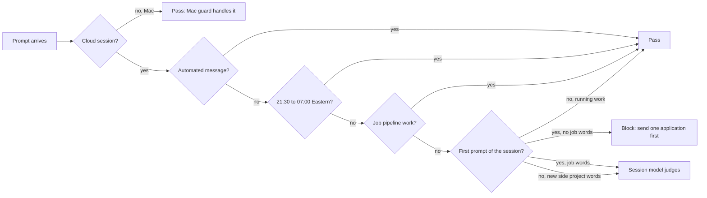

# Cloud sessions follow the owner's focus clock (11 Nov 2026)

Cloud sessions do not run the Mac's `~/.claude/hooks/focus-guard.py`, so `.claude/hooks/focus-guard-cloud.py` (registered in `.claude/settings.json` as a `UserPromptSubmit` hook) applies the same rule here. It acts only when `CLAUDE_CODE_REMOTE=true`; on the Mac it exits at once.

Why this picture: the only thing ever stopped is a typed prompt that starts new side work in the day; everything else flows through.

- Time is `America/New_York`, because cloud runs in UTC.
- `applied <n> <companies>` earns 15 min per application for that cloud session (cap 120).
- Any error in the hook exits 0, so it can never break Claude Code.
- Test: `python3 .claude/hooks/test_focus_guard_cloud.py` (runs only this guard, not the app suite).
