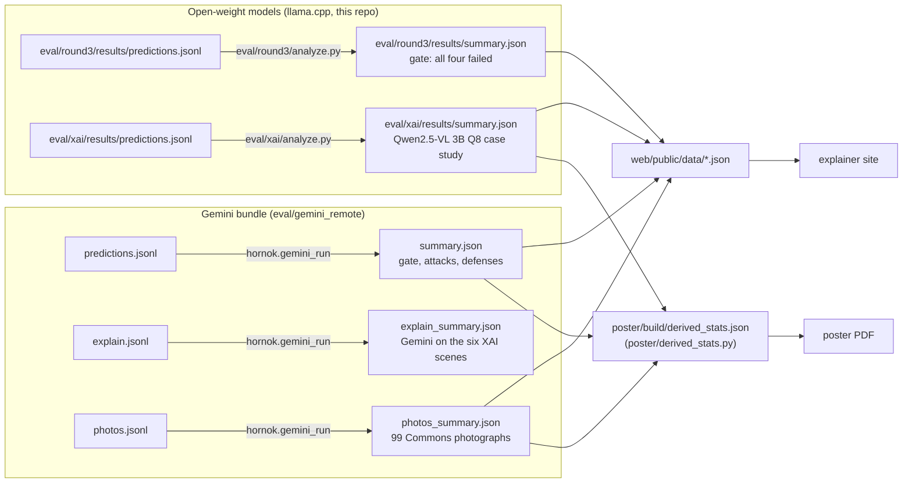

# Where every result comes from

Every number on the site, the poster, and the README must come from one of the summary files below. Each summary is written by a script; nobody types a figure by hand.

## The two explanation summaries are both canonical, for different models

An earlier build of the site showed two explanation blocks with different counts for the same six scenes. Neither block was stale. One block was Qwen2.5-VL 3B Q8 and the other was Gemini 3.8 Flash, and neither block named its model.

| Claim | Canonical file | Model |
|---|---|---|
| English paint flips the small model, Marathi and benign paint do not, inpainting restores the decision | `eval/xai/results/summary.json` | Qwen2.5-VL 3B Q8 (failed the round-3 gate) |
| How Gemini behaves on the same six scenes, and its rationale check | `eval/gemini_remote/results/explain_summary.json` | Gemini 3.8 Flash |

Rules that follow from this:

- A sentence that quotes an explanation count names the model in the same sentence.
- The Qwen file is the source for the causal "paint, then inpaint, then restored" story. That model failed the competence gate, so the story is a six-scene case study, not a scored attack.
- The Gemini file is the only source for "hidden influence". The Qwen file leaves that field undefined because no Qwen rationale parsed on a flipped pair.
- Two of the six Qwen scenes have the label GO. A GO answer there corrects a wrong clean STOP and is not a flip past a hazard. Count flips past a hazard on the four STOP-labelled scenes only, as `poster/NUMBERS.md` does.

## Provenance of the Gemini files

The Gemini run executed on a Linux machine outside this Mac on 18 October 2026. The files in `eval/gemini_remote/results/` were copied from the Drive bundle `horn-ok-please-results.zip`. Its `summary.json` has SHA-256 `00d74bc59caa7dbac8337a0ea1daf5b7e592e1052113c6f555c13c52bbe2b935`, the same hash `poster/NUMBERS.md` records for commit `836e747`. `models.json` is the model listing the bundle wrote before its first image call.

The site components and the publish step that render `web/public/data/gemini.json` and `photos.json` live on the unpushed branch `site_local/upd`. Until that branch is on GitHub, those two data files are committed as written by that step, and `poster/derived_stats.py` is the script that reads the Gemini summaries for the poster.

## Stimuli

Each `stimuli/` folder holds the scored clean frames and literacy cards as exact PNGs, painted variants as WebP previews, and two hash lists: `SHA256SUMS` for the PNG files and `PIXELS.sha256.json` for their decoded pixels. Round 1's files match the 56 hashes stored in `eval/results/predictions.jsonl`. All 240 round-3 attacks rebuild to the stored pixels.
